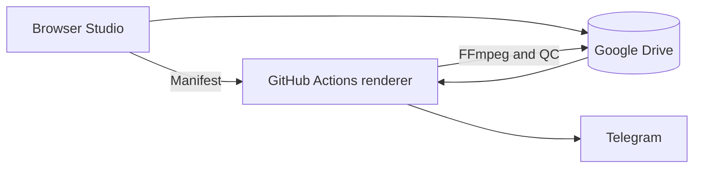

<div align="center">

**English** · [Русский](README.ru.md)

# STORY NEXUS STUDIO
#
</div>

---

## V9.0 · Production Workspace

**From script to cloud-rendered video.**

[](#status)
[](https://github.com/ZermeXX/aetherflow-render)
[](https://zermexx.github.io/aethercombine-studio/)

## Status

V9.0 is under development in the workspace-isolation branch. The deployed studio is separate from this development build. The renderer retains its V8.1 contract.

## Production modules

| Studio module (planned V9 branding) | Existing capabilities |
|---|---|
| Nexus Script | VerbaFlow scripts, chapters, narration normalization and multilingual SRT |
| Nexus Montage | Scene timeline, hybrid synchronization, audio mixer, broadcast graphics |
| Nexus Ambient | Multi-hour loops, act transitions and inserts |
| Nexus Cover | A/B/C thumbnails and feed preview |
| Nexus Art | Image editing, background removal, resizing and branding |
| Nexus Growth | Titles, descriptions, chapters, tags and release cards |
| Nexus Voice / Nexus Shorts | V9 module redesign roadmap |

HISTOVIVA and The Whisker Trio have separate project workspaces in V9 development. Ambient is reserved for The Whisker Trio.

## Architecture



The browser is the control center; heavy rendering runs in the separate renderer repository. Python mirrors in Studio are not the executable production pipeline.

## Quick start

```bash
git clone https://github.com/ZermeXX/aethercombine-studio.git
cd aethercombine-studio
bun install
bun run dev
bun run typecheck
bun test
bun run build
```

## Production workflow

Import and validate the manifest, configure scenes, export JSON, run a 720p preview, inspect qc_report.json and review the actual video and audio before launching the 4K master. Lossless round-trip preserves the original manifest version; migration is a separate operation.

## Security and configuration

Google OAuth and GitHub PAT are session credentials; repository, branch and folder identifiers are configuration. Never commit tokens or service account private keys. Renderer secrets include RCLONE_CONFIG (or RCLONE_CONFIG_BASE64), GDRIVE_FOLDER_ID and optional Google OAuth and Telegram credentials. See the Russian technical reference for the original configuration tables, historical QC and repository layout.

## Development and validation

React 19 · TypeScript · Vite · Bun · Canvas · Google Drive API · GitHub Actions.

Use [Actions](https://github.com/ZermeXX/aethercombine-studio/actions) to inspect regression results. Passing CI does not establish production acceptance. Do not deploy a development branch as the live studio without review.

## License

Apache 2.0. See [LICENSE](LICENSE).

[Full Russian technical reference](README.ru.md)
