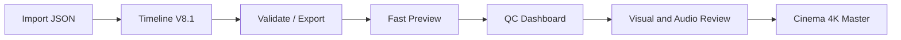
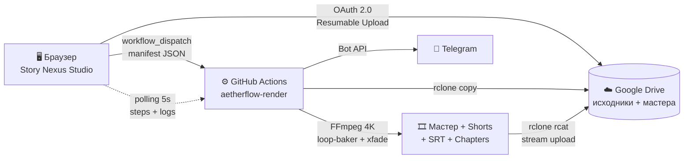

<div align="center">

[English](README.md) · **Русский**

</div>

<div align="center">

# STORY NEXUS STUDIO
### V9.0 · Production Workspace

**Облачная студия 4K-продакшна для YouTube — от сценария до готового мастера на Google Drive**

[](#)
[](https://github.com/ZermeXX/aethercombine-studio/actions/workflows/deploy.yml)
[](https://zermexx.github.io/aethercombine-studio/)
[](#)
[](#)
[](#)
[](LICENSE)

[**🌐 Открыть студию**](https://zermexx.github.io/aethercombine-studio/) · [**⚙️ Репозиторий раннера**](https://github.com/ZermeXX/aetherflow-render) · [**📋 Задачи для агента**](tasks/)

</div>

---

## V8.1 · Production Control Center

| Модуль | Возможности |
|---|---|
| **Timeline** | Настройки каждой сцены: камера, переходы, синхронизация, звук и CTA |
| **Lossless Round-Trip** | Сохранение исходных полей полных манифестов V8.0/V8.1 при импорте и экспорте; контролируемые изменения |
| **Hybrid Sync** | Native, Hybrid, Freeze, Stretch, Loop; ограничение продления до 2 с |
| **Audio Mixer** | Исходное окружение MP4, диктор, внешний эмбиент, Adaptive Audio и Smart Ducking |
| **Broadcast Graphics** | Lower Third, Brand Identity, Subscribe & Bell с настройкой SFX |
| **Render Control** | Fast Preview 720p или Cinema 4K Master |
| **Enhanced QC Dashboard** | Локальный импорт qc_report.json, кадры, A/V delta, LUFS, True Peak, диагностика дорожек и CTA |

### Производственный маршрут



1. Импортируйте манифест и проверьте таймлайн.
2. Настройте сцены и экспортируйте JSON; для строгой проверки V8.1 используйте manifest_version 8.1.
3. Запустите Fast Preview и дождитесь завершения GitHub Actions.
4. Загрузите qc_report.json в Enhanced QC Dashboard.
5. Просмотрите и прослушайте фильм; только после приёмки запускайте Master.

> QC-индикаторы не заменяют режиссёрскую приёмку. Lossless-экспорт сохраняет исходную версию манифеста; миграция версии — отдельная операция.

### HISTOVIVA EP02 · контрольный Preview #35

| Сцены | Хронометраж | Кадры | A/V delta | LUFS | True Peak |
|---:|---:|---:|---:|---:|---:|
| 34 | 05:04.500 | 7308/7308 | 0 ms | −14.15 | −1.41 dBTP |

Технический QC пройден; финальная коррекция громкости CTA и приёмка 4K Master ещё впереди.

---

## ✨ Что это

**Story Nexus Studio** — браузерный комбайн для производства двух форматов видео под канал [@Histoviva](https://youtube.com/@Histoviva):

- 🏛️ **Документальные фильмы** (~8–16 мин, 100–200+ сцен) — покадровый таймлайн, дикторская озвучка, lower-thirds, субтитры.
- 🌙 **Многочасовые ambience-лупы** (3–10 ч, 4K) — бесшовные петли, кроссфейды актов, асимметричные врезки, loudnorm.

Вся тяжёлая работа (FFmpeg, апскейл, склейка, нормализация звука) выполняется **не в браузере**, а в GitHub Actions. Студия собирает манифест, отправляет его в раннер и показывает живой прогресс.

> 💡 **Ключевая идея:** браузер = пульт управления, GitHub Actions = рендер-ферма, Google Drive = файловое хранилище. Для облачного рендера не требуется скачивать мастер на компьютер.

---

## 🏗️ Архитектура



### ⚠️ Два репозитория — не путать

| Репозиторий | Роль | Что внутри |
|---|---|---|
| **`aethercombine-studio`** *(этот)* | UI + деплой Pages | React/TS, `deploy.yml`, `ai-fix-web.yml` |
| **`aetherflow-render`** | Исполняемый раннер | `build_timeline.py`, `assemble_scenes.py`, `shorts_factory.py`, `render_loop.yml`, `render_scenes.yml` |

> Python-файлы в этом репозитории — **legacy-зеркала**, раннер их не исполняет. Правки пайплайна вносятся только в `aetherflow-render`.

---

## 🎛️ Цеха студии

| Вкладка | Назначение |
|---|---|
| 🎬 **Nexus Montage** | N-сцен таймлайн, ритм-карта (Historical / Ambient), адаптивный аудио-микшер, drift-guard, оверлеи |
| 🔁 **Nexus Ambient** | Конструктор актов (1–50+ слотов), бесшовные петли, врезки `inserts[]`, скраббер, пресеты 3/5/8/10 ч |
| 📝 **Nexus Script** | Анти-ИИ ритмика, хуки, дикторская нормализация, разбивка на главы, мультиязычный SRT |
| 📈 **Nexus Growth** | A/B/C заголовки, описание, кликабельные главы, 30 тегов, `RELEASE_CARD.md` |
| 🎨 **Nexus Cover** | 3 независимые обложки A/B/C, Flux.1 (AI Horde / Cloudflare), 20 бейджей, drag & drop заголовка, тест в ленте |
| 🖼️ **Nexus Art** | Удаление фона, волшебная палочка, ресайз, цветокоррекция, SVG-инфографика, брендинг канала |


| 🎙️ **Nexus Voice** | Озвучивание |
| 📱 **Nexus Shorts** | Короткие вертикальные видео |

---

## 🚀 Быстрый старт

```bash
git clone https://github.com/ZermeXX/aethercombine-studio.git
cd aethercombine-studio

bun install          # или npm install
bun run dev          # → http://localhost:5173
```

Сборка и проверка типов:

```bash
bun run typecheck
bun test tests/manifest-v8.test.ts tests/manifest-v81.test.ts tests/manifest-roundtrip.test.ts
bun run build
bun run preview
```

<details>
<summary><b>🔧 Требования</b></summary>

- [Bun](https://bun.sh) ≥ 1.1 (или Node.js ≥ 20 + npm)
- Аккаунт Google с доступом к Drive API
- Fine-grained GitHub PAT с правами **Actions: Read and write** на репозиторий раннера
- Настроенные Secrets в `aetherflow-render` (см. ниже)

</details>

---

## 🔐 Конфигурация

### В браузере (модалка «Подключение GitHub Раннера»)

| Поле | Где хранится | Назначение |
|---|---|---|
| GitHub PAT | `sessionStorage` | Вызов `workflow_dispatch`, отмена run, чтение логов |
| Репозиторий / ветка | `localStorage` | Цель dispatch (не секрет) |
| GDRIVE_FOLDER_ID | `localStorage` | Целевая папка на Drive |
| Google OAuth | `sessionStorage` | Прямая загрузка исходников (Resumable API v3) |
| Telegram Bot / Chat | `sessionStorage` | Уведомления из браузера |

### В GitHub Secrets репозитория **раннера**

```
RCLONE_CONFIG          # rclone.conf целиком (или RCLONE_CONFIG_BASE64)
GDRIVE_CLIENT_ID       # опционально, свой OAuth-клиент
GDRIVE_CLIENT_SECRET
GDRIVE_FOLDER_ID
TELEGRAM_BOT_TOKEN     # опционально
TELEGRAM_CHAT_ID
```

> 🛡️ **Приватный ключ Service Account никогда не попадает в браузер.** Он живёт только в GitHub Secrets и используется раннером.

---

## 🛡️ Безопасность

- ✅ OAuth-токен Google и GitHub PAT — **только `sessionStorage`**, стираются при закрытии вкладки
- ✅ Legacy-ключи автоматически мигрируют из `localStorage` и удаляются оттуда
- ✅ `sanitizeLogText()` маскирует токены в терминале, в «Копировать лог» и в персисте джобы
- ✅ Манифест перед отправкой очищается от полей `bot_token`, `pat`, `access_token`, `private_key`, …
- ✅ Preflight-гейт: запуск и копирование `filter_complex` заблокированы при пустых `file_name`

Проверка в консоли браузера (должно вернуть `[]`):

```js
Object.entries(localStorage).filter(([k, v]) =>
  /ya29\.|access_token|github_pat_|ghp_|bot_token|api_token|private_key/i.test(k + v)
)
```

---

## 📁 Структура

```
aethercombine-studio/
├── .github/workflows/
│   ├── deploy.yml           # сборка + деплой на GitHub Pages
│   └── ai-fix-web.yml       # Gemini-агент → автоматический PR
├── src/
│   ├── components/          # цеха студии, терминал, шейдерный фон
│   ├── utils/
│   │   ├── aetherPersistence.ts    # профиль в localStorage, токены в sessionStorage
│   │   ├── logSanitizer.ts         # маскирование секретов
│   │   ├── manifestDispatch.ts     # компактная сериализация манифеста
│   │   ├── manifestV21.ts          # парсер v2.1/v2.2
│   │   ├── englishExport.ts        # SEO-блок, главы, англ. тайтлы
│   │   └── thumbnailPresetsAndEffects.ts
│   ├── googleDriveAuth.ts   # OAuth + silent refresh + chunked resumable upload
│   ├── App.tsx              # оркестратор: манифест, dispatch, polling
│   └── main.tsx
├── tasks/                   # задачи для AI-агента (fix-counters.md, …)
├── vite.config.ts           # base path для Pages — не менять!
└── firebase-applet-config.json
```

---

## 🔄 CI/CD

| Workflow | Триггер | Что делает |
|---|---|---|
| **Deploy** | push в `main` | `bun install` → typecheck → manifest tests → build → публикация на GitHub Pages |
| **AI Fix Web** | ручной `workflow_dispatch` | Gemini CLI читает `tasks/*.md`, правит код, гоняет typecheck + build, открывает PR |

Запуск агента: **Actions → AI Fix Web (Gemini) → Run workflow →** `task_file = tasks/fix-counters.md`
*(нужен секрет `GEMINI_API_KEY`)*

---

## 🧰 Технологический стек

**Frontend:** React 19 · TypeScript · Vite · Tailwind CSS · motion/react · lucide-react
**Хранилище:** Firebase Auth · Google Drive API v3 (Resumable, чанки 8 МБ с докачкой)
**Графика:** HTML5 Canvas (4K-экспорт, бинарное сжатие JPEG < 2 МБ) · WebGL-шейдеры · Flux.1-Schnell
**Раннер:** Python 3 · FFmpeg (`xfade`, `acrossfade`, `loudnorm`, `ebur128`) · rclone · GitHub Actions

---

## 🗺️ Roadmap

- [x] **P0** — бесшовный loop-baker, честные кроссфейды актов, stream-upload, санитайз секретов, preflight-гейт, 20 бейджей, End Screen от реальной длительности
- [ ] **P1** — единый store манифеста, waveform мастер-аудио, ассет-браузер Drive, дальнейшая оптимизация больших таймлайнов
- [ ] **P2** — иконки вместо эмодзи, i18n, blind A/B-тест обложек, ONNX-сегментация для удаления фона

---

## 📄 Лицензия

Распространяется под лицензией **Apache 2.0**. См. заголовки `SPDX-License-Identifier: Apache-2.0` в исходниках.

<div align="center">

**Сделано для [@Histoviva](https://youtube.com/@Histoviva)**

*Cloud 4K Production Pipeline · GitHub Actions FFmpeg + Rclone Google Drive*

</div>
